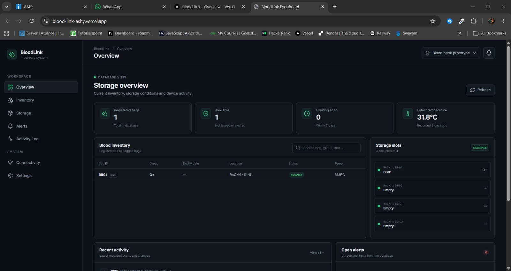
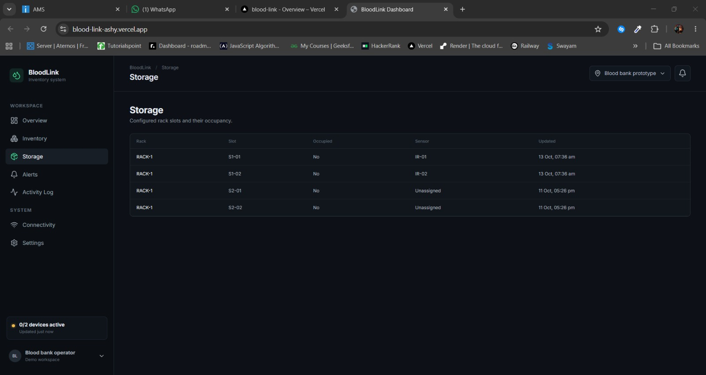
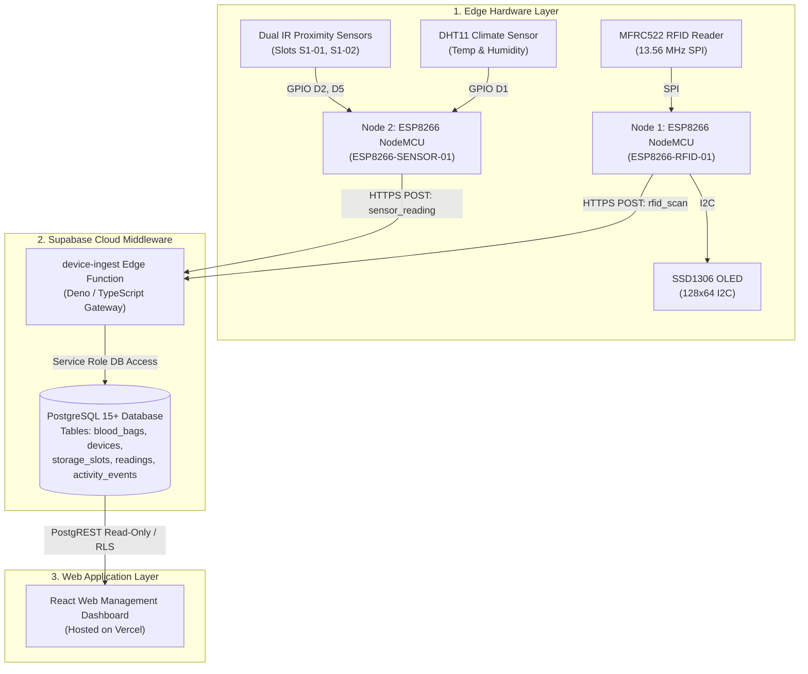

# BloodLink: Smart IoT-Based Blood Bank Monitoring & Management System

[](LICENSE)
[](https://www.espressif.com/en/products/socs/esp8266)
[](https://supabase.com)
[](https://blood-link-ashy.vercel.app)
[](hardware/README.md)

An end-to-end IoT prototype combining RFID-based blood-bag tracking, optical slot occupancy sensing, cold-chain environmental monitoring, and cloud-synchronized web inventory management.

---

## 📸 Prototype & Dashboard Showcase

| 3D-Printed Rack Enclosure | Compartment Interior & Wiring |
| :---: | :---: |
|  |  |
| *Front control panel featuring SSD1306 OLED and RC522 RFID reader* | *Hinged door open, showing compartment S1-01 and RFID transponder* |

| Live Web Inventory Dashboard | Real-Time Storage Slot Occupancy |
| :---: | :---: |
|  |  |
| *Overview metric cards, live inventory table, and cold-chain temperature* | *Optical IR slot status across the 4-compartment storage model* |

---

## 📌 Executive Summary & Problem Statement

Blood products are scarce, perishable, and life-critical medical resources. In many small blood banks and emergency storage units, inventory tracking relies heavily on manual ledgers or spreadsheets. This manual overhead creates critical vulnerabilities:
* **Delayed Stock Visibility**: Time wasted locating compatible blood groups during emergency transfusions.
* **Cold-Chain Deviations**: Undetected temperature fluctuations between periodic manual thermometer checks.
* **Avoidable Wastage**: Unnoticed expiration of blood units placed in incorrect storage bins.

**BloodLink** bridges physical blood storage with cloud intelligence. Using short-range RFID identification, optical infrared presence detection, environmental telemetry, and a serverless Supabase backend, the system automates stock audits, logs cold-chain conditions, and provides clinic operators with real-time stock visibility.

> **Project Scope**: BloodLink is a functional engineering proof-of-concept developed as an academic capstone project at Saintgits College of Engineering. It is designed to demonstrate IoT-assisted cold-chain management and is not a certified medical device.

---

## 🎯 Project Objectives

1. **Automated RFID Identification**: Automate blood unit identification using unique 13.56 MHz RFID tags linked to digital records.
2. **Compartment Slot Organization**: Organize storage using a 4-slot model representing major blood group categories, capable of tracking multiple individual bags per slot.
3. **Continuous Cold-Chain Monitoring**: Log storage temperature and relative humidity at regular intervals.
4. **Optical Slot Occupancy Sensing**: Use infrared proximity sensors to detect the physical presence of blood containers in real time.
5. **Decoupled Cloud Architecture**: Route telemetry through serverless Supabase Edge Functions into a PostgreSQL database with Row Level Security.
6. **Centralized Operator Dashboard**: Present inventory counts, slot occupancy, recent scan logs, and hardware connectivity on a modern web dashboard.

---

## 🏗️ System Architecture

BloodLink follows a decoupled, three-tier IoT architecture separating edge hardware, cloud middleware, and client presentation:



For the complete six-layer architecture document and state diagrams, see [docs/architecture.md](docs/architecture.md).

---

## ⚙️ Hardware Specifications & Pin Mapping

The physical model is built into a custom 3D-printed enclosure (**170 × 190 × 141 mm**, Sheet 001 CAD in [`hardware/cad/enclosure_dimensions.pdf`](hardware/cad/enclosure_dimensions.pdf)) driven by two independent ESP8266 NodeMCU controllers.

### MCU1: RFID Scanning & Local Display (`ESP8266-RFID-01`)
* **Role**: Scans blood bag RFID tags, queries cloud backend, and renders local operator feedback across 3 OLED pages.
* **Wiring Table**:

| Peripheral | Board Pin | ESP8266 GPIO | Bus Type | Operating Voltage |
| :--- | :---: | :---: | :---: | :---: |
| **MFRC522 SDA (SS)** | `D4` | GPIO2 | SPI Chip Select | 3.3V Only |
| **MFRC522 SCK** | `D5` | GPIO14 | SPI Clock | 3.3V |
| **MFRC522 MOSI** | `D7` | GPIO13 | SPI MOSI | 3.3V |
| **MFRC522 MISO** | `D6` | GPIO12 | SPI MISO | 3.3V |
| **MFRC522 RST** | `D0` | GPIO16 | Reset | 3.3V |
| **SSD1306 OLED SCL** | `D1` | GPIO5 | I2C Clock | 3.3V (Addr: `0x3C`) |
| **SSD1306 OLED SDA** | `D2` | GPIO4 | I2C Data | 3.3V |

### MCU2: Telemetry & Slot Occupancy Node (`ESP8266-SENSOR-01`)
* **Role**: Periodically samples DHT11 temperature/humidity and IR slot occupancy; dispatches telemetry every 30 seconds.
* **Wiring Table**:

| Peripheral | Board Pin | ESP8266 GPIO | Signal Polarity | Operating Voltage |
| :--- | :---: | :---: | :---: | :---: |
| **DHT11 Data** | `D1` | GPIO5 | 1-Wire Digital | 3.3V / 5V |
| **IR Sensor 1 (Slot S1-01)** | `D2` | GPIO4 | Active LOW (Obstacle detected) | 3.3V / 5V |
| **IR Sensor 2 (Slot S1-02)** | `D5` | GPIO14 | Active LOW (Obstacle detected) | 3.3V / 5V |

For full power rail decoupling and circuit schematics, refer to [docs/hardware-and-wiring.md](docs/hardware-and-wiring.md).

---

## 🗄️ Database & Cloud Ingestion Contract

The backend uses a single serverless ingestion gateway (`device-ingest`) deployed on Supabase Edge Functions.

### API Handshakes

1. **RFID Identification (`rfid_scan`)**:
   * **Payload**: `{"type": "rfid_scan", "uid": "93 2A 14 0B"}`
   * **Headers**: `x-device-code: ESP8266-RFID-01`, `x-device-secret: <SECRET>`
   * **Response**: Returns blood bag metadata (`bag_code`, `blood_group`, `status`, `expiry_date`), latest storage temperature, and creates an audit entry in `activity_events`.

2. **Environmental Telemetry (`sensor_reading`)**:
   * **Payload**: `{"type": "sensor_reading", "temperature_c": 24.5, "humidity_pct": 65.0, "slots": [{"sensor_id": "IR-01", "occupied": true}, ...]}`
   * **Response**: Persists readings to `readings` table, updates `storage_slots.is_occupied`, and refreshes `devices.last_seen_at`.

For detailed JSON schemas and error codes, refer to [docs/api-contract.md](docs/api-contract.md). Database initialization DDL is in [`supabase/migrations/20241001000000_init_schema.sql`](supabase/migrations/20241001000000_init_schema.sql).

---

## 🚀 Quick Start Guide

### 1. Repository Setup
```bash
git clone https://github.com/aswinsanthosh2006/BloodLink.git
cd BloodLink
```

### 2. Configure Firmware Secrets
Copy the example header in both firmware directories:
```bash
# MCU1
cp firmware/mcu1-rfid-oled/secrets.example.h firmware/mcu1-rfid-oled/secrets.h

# MCU2
cp firmware/mcu2-sensors/secrets.example.h firmware/mcu2-sensors/secrets.h
```
Edit both `secrets.h` files with your local 2.4 GHz Wi-Fi SSID, password, Supabase endpoint URL, and device secret.

### 3. Flash Microcontrollers
1. Open Arduino IDE 2.x and install the **ESP8266 Board Package** (v3.1.2+).
2. Install required libraries: `ArduinoJson`, `MFRC522`, `Adafruit SSD1306`, `Adafruit GFX`, `DHT sensor library`.
3. Select **NodeMCU 1.0 (ESP-12E Module)**.
4. Upload `firmware/mcu1-rfid-oled/mcu1_rfid_oled.ino` to Node 1.
5. Upload `firmware/mcu2-sensors/mcu2_sensors.ino` to Node 2.

For in-depth flashing instructions and troubleshooting, see [docs/setup-and-testing.md](docs/setup-and-testing.md).

---

## 🧪 Implementation & Verification Status

To ensure engineering transparency, project features are explicitly categorized by verification state:

| Feature / Subsystem | Status | Evidence / Verification Method |
| :--- | :---: | :--- |
| **RFID Tag Identification** | **Verified** | Scans unique UID, verifies record, displays bag details on OLED |
| **OLED Multi-Page Display** | **Verified** | Sequential display of bag identity, validity dates, and storage temp |
| **Dual-IR Slot Occupancy** | **Verified** | Active LOW sensing updates slots S1-01 & S1-02 on web dashboard |
| **Cold-Chain Telemetry Logging**| **Verified** | DHT11 samples temp & humidity every 30s to Supabase `readings` |
| **Device Heartbeat Monitoring** | **Verified** | Web UI transitions device state based on `devices.last_seen_at` |
| **Live Web Management UI** | **Verified** | React app deployed on Vercel (`blood-link-ashy.vercel.app`) |
| **Slots S2-01 / S2-02 IR Expansion**| **Planned** | Compartments physically modeled; unassigned in firmware |
| **Active Refrigeration Control** | **Planned** | Prototype operates in ambient testing; Peltier/compressor is future scope |
| **Automated Expiry Alerts (Email/SMS)**| **Planned** | Data model supports expiry; alert notification triggers planned |

---

## 📂 Repository Structure

```text
BloodLink/
├── README.md                           # Main engineering portfolio documentation
├── LICENSE                             # MIT License
├── .gitignore                          # C++, Arduino, VS Code, and secret exclusions
├── firmware/
│   ├── mcu1-rfid-oled/
│   │   ├── mcu1_rfid_oled.ino          # Arduino sketch for RFID scanning & OLED display
│   │   ├── secrets.example.h           # Credential template for Node 1
│   │   └── README.md                   # Flashing guide, pinout, and library specifications
│   └── mcu2-sensors/
│       ├── mcu2_sensors.ino            # Arduino sketch for DHT11 & IR slot occupancy
│       ├── secrets.example.h           # Credential template for Node 2
│       └── README.md                   # Sensor calibration, upload intervals, and pinout
├── supabase/
│   ├── README.md                       # Backend overview & architecture
│   ├── functions/
│   │   └── device-ingest/
│   │       └── index.ts                # Deno Edge Function API implementation
│   └── migrations/
│       └── 20241001000000_init_schema.sql # PostgreSQL schema DDL with RLS policies
├── web/
│   └── README.md                       # Dashboard overview, live deployment link, and tech stack
├── docs/
│   ├── architecture.md                 # Six-layer system architecture & Mermaid diagrams
│   ├── hardware-and-wiring.md          # Complete Pinout matrix, electrical rails, and CAD specs
│   ├── api-contract.md                 # Detailed request/response schemas and status codes
│   ├── setup-and-testing.md            # Step-by-step reproduction and verification guide
│   ├── BloodLink_Mini_Project_Report.pdf # Official 39-page B.Tech Mini Project Report
│   └── images/                         # Authentic prototype photos and dashboard screenshots
└── hardware/
    ├── README.md                       # BOM, cost breakdown, and enclosure documentation
    └── cad/
        └── enclosure_dimensions.pdf    # 3D enclosure CAD drawing (Sheet 001)
```

---

## 👥 Project Team & Academic Credits

Developed as a B.Tech Mini Project in the **Department of Electronics Engineering**, **Saintgits College of Engineering (Autonomous)**, Kottayam, affiliated to **APJ Abdul Kalam Technological University (KTU)** (October 2026).

| Member Name | University Reg. No. | Core Contributions |
| :--- | :---: | :--- |
| **Aswin S** | `MGP23ECE018` | ESP8266 firmware development, MFRC522 RFID reader interfacing, embedded C++ |
| **Abhijith Santhosh** | `MGP23ECE001` | Project documentation, 3D rack CAD fabrication, OLED display interfacing |
| **Elias Janson** | `MGP23ECE022` | Sensor node firmware, DHT11 climate sensing, IR optical slot integration |
| **Johan Paul** | `MGP23CS082` | Supabase cloud architecture, Edge Function development, React web dashboard |

* **Project Supervisor**: Er. Anish M George (Assistant Professor, Dept. of Electronics Engineering)
* **Project Coordinator**: Er. Jyothi Krishnan M
* **Program Coordinator**: Er. Marie Kottayil James

---

## ⚖️ License & Disclaimers

This project is licensed under the **MIT License** — see the [LICENSE](LICENSE) file for details.

### Medical & Experimental Disclaimer
> **IMPORTANT**: BloodLink is an educational and academic engineering prototype. Radio Frequency Identification (RFID) verifies transponder tag identifiers only and does not determine the biochemical validity, blood type accuracy, sterility, or clinical suitability of any blood unit. Temperature readings generated by the prototype represent local environmental conditions and do not certify clinical compliance with cold-chain transfusion standards.