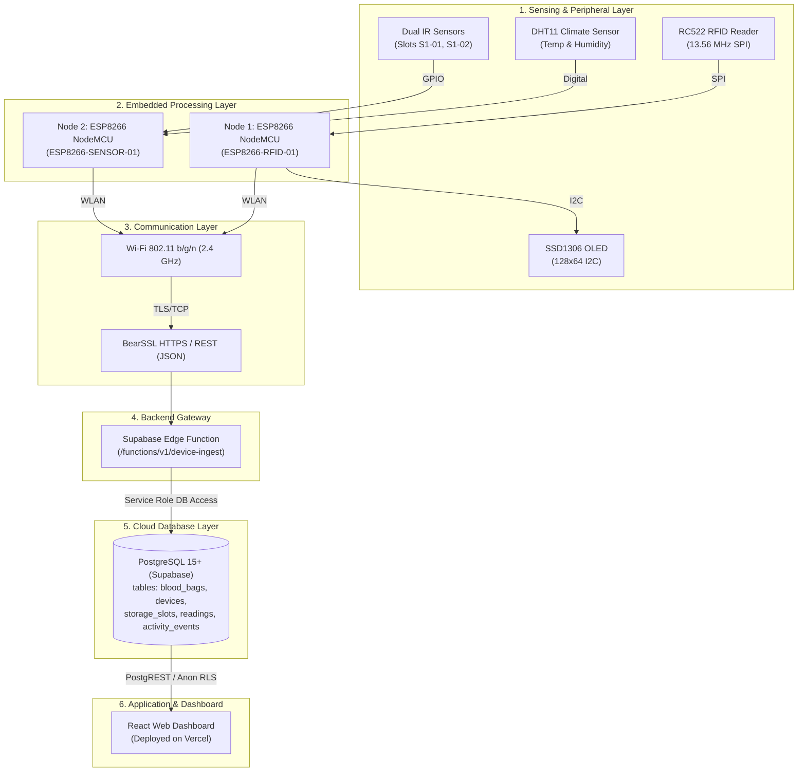
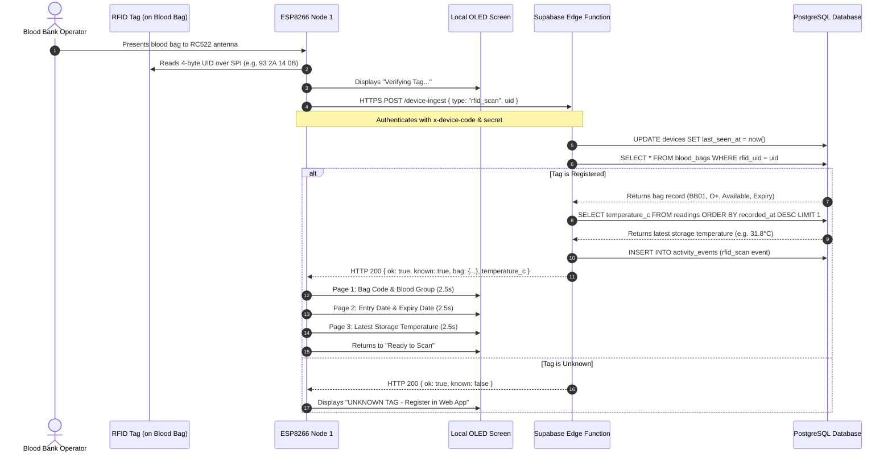
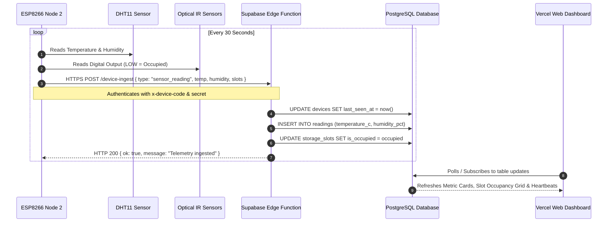

# System Architecture & Data Flow

This document details the multi-tier engineering architecture, hardware-software integration, and separate data pipelines operating in **BloodLink**.

---

## 🏛️ Six-Layer Logical Architecture

---

## 🔄 Separate Data Flow Pipelines

### 1. RFID Blood Bag Scan Pipeline (Interactive / Event-Driven)

---

### 2. Environmental Telemetry & Slot Occupancy Pipeline (Periodic)

---

## 🛡️ Security Boundaries & Trust Architecture

1. **Edge Node Authentication**: Nodes are isolated from direct database write privileges. Every ingestion request must pass through the `device-ingest` Edge Function with matching `x-device-code` and `x-device-secret`.
2. **Dashboard Permissions**: The web client uses read-only PostgREST queries backed by PostgreSQL **Row Level Security (RLS)**. No administrative credentials or write keys are exposed to the browser.
3. **Hardware Independence**: The two microcontrollers communicate purely through the cloud backend. Failure or power loss on one node does not interrupt the operations of the other.
