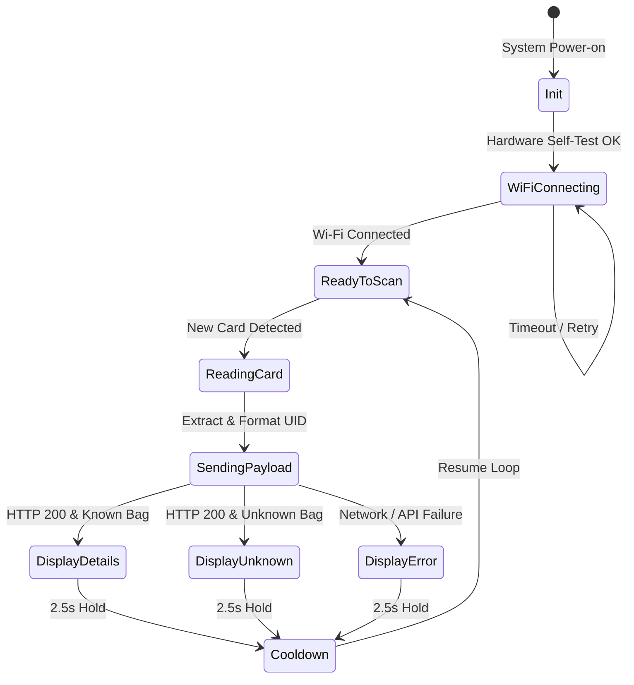

# MCU1 Firmware — RFID Scanner & OLED Display

Firmware for the primary identification node (`ESP8266-RFID-01`) in the **BloodLink** Smart Blood Bank system.

---

## 📋 Responsibilities

* **Identification**: Reads 13.56 MHz RFID tags attached to blood bags using the MFRC522 reader over SPI.
* **Cloud Ingestion**: Sends real-time HTTPS POST requests to the Supabase Edge Function (`/functions/v1/device-ingest`) with device identity headers.
* **Local Operator Feedback**: Displays bag identity (Bag ID, Blood Group, Status), entry/expiry dates, and real-time environmental storage temperature across formatted OLED screens.
* **Scan Throttling**: Implements a 2.5-second cooldown debounce to avoid duplicate scans while actively handling tag presence.

---

## 🔌 Hardware Connections

### Pin Mapping Matrix (NodeMCU v2/v3 ESP8266)

| Peripheral Module | Peripheral Pin | ESP8266 Pin | GPIO Pin | Interface | Notes |
| :--- | :--- | :--- | :--- | :--- | :--- |
| **MFRC522 RFID** | SDA / SS | **D4** | GPIO2 | SPI Chip Select | Pulled HIGH internally on boot |
| | SCK | **D5** | GPIO14 | SPI Clock | Hardware SPI Clock |
| | MOSI | **D7** | GPIO13 | SPI MOSI | Master Out Slave In |
| | MISO | **D6** | GPIO12 | SPI MISO | Master In Slave Out |
| | RST | **D0** | GPIO16 | Digital Output | Hardware Reset pin |
| | 3.3V | **3V3** | — | Power | **Do not connect to 5V** (3.3V logic) |
| | GND | **GND** | — | Ground | Common system ground |
| **SSD1306 OLED (128x64)** | SDA | **D2** | GPIO4 | I2C Data | 4.7kΩ pull-up to 3.3V recommended |
| | SCL | **D1** | GPIO5 | I2C Clock | 4.7kΩ pull-up to 3.3V recommended |
| | VCC | **3V3** | — | Power | Powered from 3.3V rail |
| | GND | **GND** | — | Ground | Common system ground |

> **Warning**: The MFRC522 reader is strictly a **3.3V** module. Connecting `VCC` to 5V will permanently damage the transceiver IC.

---

## 🛠️ Required Software & Libraries

Install the following dependencies using the **Arduino IDE Library Manager** (`Ctrl + Shift + I`):

1. **esp8266** by ESP8266 Community (via Board Manager: `http://arduino.esp8266.com/stable/package_esp8266com_index.json`, version >= 3.1.2)
2. **ArduinoJson** by Benoit Blanchon (Version 7.x or 6.21.x)
3. **MFRC522** by GithubCommunity (v1.4.10 or later)
4. **Adafruit SSD1306** by Adafruit (v2.5.9 or later)
5. **Adafruit GFX Library** by Adafruit (v1.11.9 or later)

---

## 🔐 Credentials Configuration

1. In `firmware/mcu1-rfid-oled/`, create a copy of `secrets.example.h` and rename it to `secrets.h`:
   ```bash
   cp secrets.example.h secrets.h
   ```
2. Open `secrets.h` and populate with your credentials:
   ```c
   const char* WIFI_SSID     = "Your_WiFi_Network";
   const char* WIFI_PASSWORD = "Your_WiFi_Password";
   const char* ENDPOINT      = "https://<your-project>.supabase.co/functions/v1/device-ingest";
   const char* DEVICE_CODE   = "ESP8266-RFID-01";
   const char* DEVICE_SECRET = "Your_Generated_Secret_Key";
   ```
3. `secrets.h` is already included in `.gitignore` to prevent leaking credentials to public repositories.

---

## 🚀 Flashing & Upload Instructions

1. Open `mcu1_rfid_oled.ino` in Arduino IDE.
2. Select Board: **NodeMCU 1.0 (ESP-12E Module)** or **Generic ESP8266 Module**.
3. Settings:
   * **CPU Frequency**: 80 MHz (or 160 MHz for faster TLS handshakes)
   * **Flash Size**: 4MB (FS: 1MB / OTA:~1014KB)
   * **Upload Speed**: 115200 (or 921600 for rapid flashing)
   * **Port**: Select the COM port corresponding to the USB-UART converter (CH340 / CP2102).
4. Click **Upload** (`Ctrl + U`).
5. Open Serial Monitor at **115200 baud** to view initialization diagnostics.

---

## 🔄 Firmware Workflow & State Machine



---

## 🔒 Security & TLS Verification Notes

* **Current Implementation**: `client.setInsecure()` is used for academic prototype demonstrations to bypass root certificate validation, allowing execution within the ESP8266's limited RAM footprint.
* **Production Recommendation**:
  For mission-critical healthcare environments, verify the HTTPS host identity using BearSSL fingerprint pinning:
  ```cpp
  // Pinning the Supabase endpoint SHA-256 fingerprint:
  const char fingerprint[] PROGMEM = "XX XX XX ...";
  client.setFingerprint(fingerprint);
  ```
  Or load Mozilla's X.509 Root CA Trust Anchors via `BearSSL::CertStore`.

---

## ❓ Troubleshooting

| Symptom | Cause | Solution |
| :--- | :--- | :--- |
| **"OLED not found"** over Serial | I2C address mismatch or loose wiring | Verify `D1` (SCL) and `D2` (SDA). Run an I2C scanner sketch to verify if the OLED responds at `0x3C` or `0x3D`. |
| **RFID Reader fails to read tags** | Insufficient 3.3V current or SPI wiring error | Ensure `VCC` is supplied from a clean 3.3V rail capable of 50mA surges. Check `D4` (SS) and `D0` (RST). |
| **"HTTPS Error" / Error Code -1** | SSL handshake timeout or DNS resolution failure | Confirm ESP8266 CPU clock is set to 160MHz in Arduino IDE for faster RSA/TLS computation. Verify Wi-Fi internet access. |
| **"UNKNOWN TAG" displayed** | RFID UID is not pre-registered in Supabase | Copy UID from Serial Monitor and add a corresponding row in the `blood_bags` Supabase table. |
