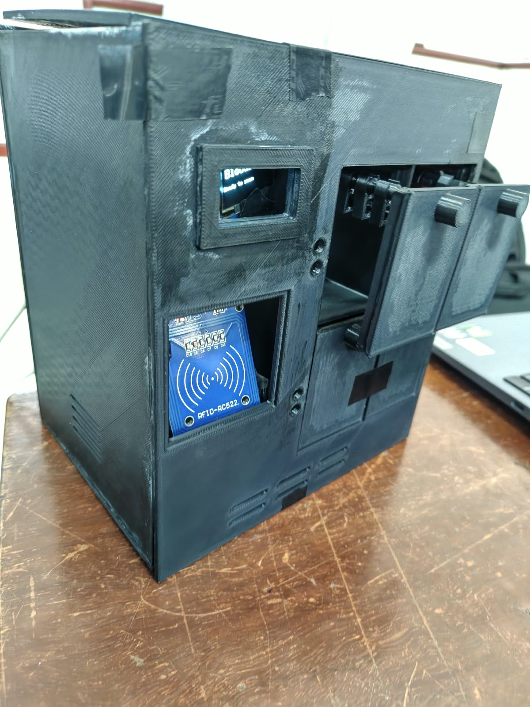
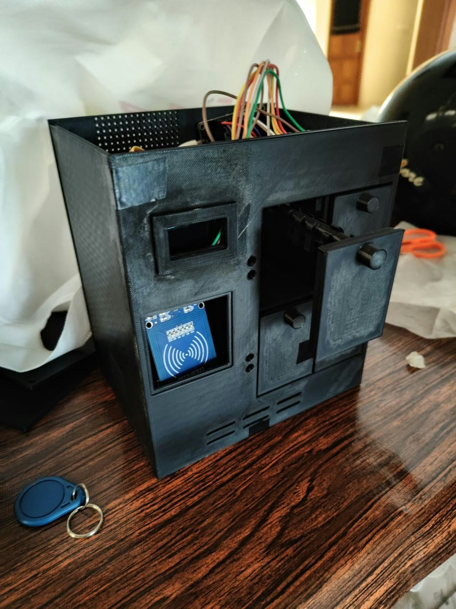

# Hardware Specifications & Enclosure Design

Documentation of the physical rack structure, CAD engineering drawings, component Bill of Materials (BOM), and power distribution for the **BloodLink** prototype.

---

## 📐 Physical Enclosure & CAD Drawing

The custom 3D-printed enclosure was modeled for desktop blood bank demonstrations, integrating a front control panel with four dedicated blood-group storage compartments.

* **Engineering Drawing Reference**: Sheet 001 (`hardware/cad/enclosure_dimensions.pdf`)
* **Outer Dimensions**: **170 mm** (Width) × **190 mm** (Height) × **141 mm** (Depth)
* **Compartment Depth**: **123.8 mm**
* **Enclosure Features**:
  * Dedicated recessed bezel for the **SSD1306 OLED** (128×64) screen.
  * Direct front-facing window for the **MFRC522 RFID** transceiver antenna.
  * 4 individually hinged compartment doors with integrated handles.
  * Lower ventilation cooling grilles for natural airflow.
  * Open-top electronics bay allowing quick access to NodeMCU boards and wiring.

---

## 📷 Prototype Showcase

| Front View (OLED & RFID Bezel) | Open Compartment (Wiring & Key Fob) |
| :---: | :---: |
|  |  |

---

## 📋 Bill of Materials (BOM) & Cost Estimation

*(Derived from academic report cost analysis; values in INR)*

| Item # | Component | Model / Spec | Qty | Purpose | Est. Cost (₹) |
| :---: | :--- | :--- | :---: | :--- | :---: |
| 1 | **Microcontroller Board** | NodeMCU ESP8266 (ESP-12E) | 2 | Primary MCU (RFID/OLED) & Sensor Node | ₹600 – ₹800 |
| 2 | **RFID Reader** | MFRC522 (13.56 MHz SPI) | 1 | Blood bag tag identification | ₹180 – ₹250 |
| 3 | **RFID Transponders** | 13.56 MHz MIFARE Classic 1K Keyfobs | 2 | Attached to blood bag units | ₹50 – ₹100 |
| 4 | **Display Module** | 0.96" SSD1306 OLED (I2C, 128×64) | 1 | Local operator status & scan feedback | ₹200 – ₹300 |
| 5 | **Climate Sensor** | DHT11 Digital Sensor | 1 | Temperature and relative humidity monitoring | ₹100 – ₹150 |
| 6 | **Proximity Sensors** | Infrared Obstacle Sensor (LM393) | 2 | Compartment slot presence detection | ₹120 – ₹180 |
| 7 | **Enclosure** | Custom 3D Printed PLA Structure | 1 | Physical chassis and hinged doors | ₹500 – ₹1,500 |
| 8 | **Power & Wiring** | 5V Regulated Supply, Breadboard, Jumpers | Misc | System power rail and interconnection | ₹200 – ₹400 |
| **Total** | | | | | **₹1,950 – ₹3,680** |

---

## ⚡ Power Distribution Architecture

Both ESP8266 nodes and their attached peripherals are powered through a shared, regulated 5V DC supply:

1. **5V Rail**: Feeds the `VIN` / `5V` pins of both NodeMCU boards and powers the IR proximity sensors.
2. **3.3V Rail**: Regulated on-board by the NodeMCU LDOs (AMS1117-3.3).
   * **Node 1 (3.3V)**: Powers the MFRC522 RFID reader (**strict 3.3V max**) and the SSD1306 OLED display.
   * **Node 2 (3.3V)**: Powers the DHT11 sensor data pull-up resistor.
3. **Common Ground**: All GND pins are tied to a shared ground bus to prevent signal ground-loops and floating logic levels.
