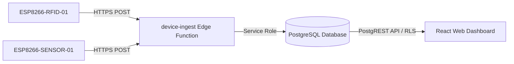

# Supabase Cloud Backend & Database

This directory contains the database schema and Edge Functions for the **BloodLink** IoT inventory management system.

---

## 🏗️ Architecture Overview

The backend acts as a centralized cloud bridge between the physical ESP8266 edge microcontrollers and the web management dashboard:



---

## 🗄️ Database Tables (`public` Schema)

| Table | Primary Key | Description |
| :--- | :--- | :--- |
| `devices` | `id` (UUID) | Registered edge microcontrollers, status, and heartbeat timestamps (`last_seen_at`). |
| `storage_slots` | `id` (UUID) | Compartment inventory model (`RACK-1`, slots `S1-01` to `S2-02`), assigned IR sensor, and occupancy status. |
| `blood_bags` | `id` (UUID) | Individual blood units mapped to unique RFID UIDs, blood group, expiry date, and status. |
| `readings` | `id` (UUID) | Time-series telemetry recording temperature (°C) and humidity (%). |
| `activity_events` | `id` (UUID) | Immutable audit log of scan events, transactions, and hardware actions. |
| `alerts` | `id` (UUID) | Cold-chain deviations and operational warnings. |

---

## 🚀 Deployment Instructions

### 1. Database Setup via Supabase Dashboard
1. Open the [Supabase Dashboard](https://app.supabase.com) and navigate to **SQL Editor**.
2. Open `supabase/migrations/20241001000000_init_schema.sql`.
3. Paste and execute the script to create tables, indices, and Row Level Security policies.

### 2. Deploying Edge Functions via Supabase CLI
```bash
# Log in to Supabase CLI
npx supabase login

# Link your local project with the remote Supabase project
npx supabase link --project-ref ycacfjmizaoegykxrtfl

# Deploy the device-ingest Edge Function
npx supabase functions deploy device-ingest --no-verify-jwt
```

---

## 🔒 Security Best Practices

* **Device Secrets**: Generated per node and matched against stored cryptographic hashes.
* **Least Privilege**: The web dashboard connects using public read access granted via PostgreSQL Row Level Security (RLS) policies. Only the `service_role` key inside Edge Functions has permission to insert and modify telemetry and inventory records.
* **Credential Isolation**: Never expose `service_role` keys in client-side bundles or firmware binaries.
